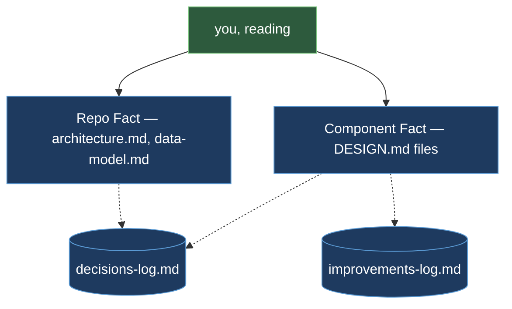

Orderflow is a docs-only skeleton of a fictional web shop checkout system. It contains no runnable source code — `src/` directories, build configs, and test suites are deliberately absent. What it does contain is a complete, discipline-faithful DTDD documentation structure: four component `DESIGN.md` files, architecture and data-model docs at the repo tier, a decisions log, an improvements log, a runbook, and the `CLAUDE.md` that governs how any agent works in this repo. Reading Orderflow from top to bottom teaches the documentation structure DTDD enforces on a real, multi-service repository before a single line of code is ever written.

## The Mental Map

Every question a newcomer asks has exactly one home in this repository. The home is chosen by tier — each tier holds a different *kind* of truth — not by what is most convenient to edit at the moment.

| Question | Document | Why it lives there |
|---|---|---|
| What does one component do, and what must stay true inside it? | That component's own `DESIGN.md` (e.g. `services/orders/DESIGN.md`) | Component Fact — one document per component, owned by whoever is changing it |
| How do the pieces connect, and where does the database live? | `docs/architecture/architecture.md` + `docs/architecture/data-model.md` | Repo Fact — the cross-component truth no single component's doc can hold |
| Why is it built this way? | `docs/decisions/decisions-log.md` | Permanent narrative — decisions and rejected alternatives, in order, never deleted |
| What is known-imperfect right now? | `docs/improvements/improvements-log.md` | Transient tracker — entries are deleted the moment they are resolved |
| How do I prove the critical behavior? | `docs/runbooks/` | Evidence for the Fact — an executable scenario, not a claim |
| What rules govern agents working here? | `CLAUDE.md` | The rules layer — reading priority, document ownership, review gates |



The two Fact tiers are solid arrows: a reader goes straight to them for present-state truth. The logs sit beside the tiers, reached only when the present-state doc raises a "why" or an "open problem" the reader wants more context on — they are never the first stop.

## The Folder Map

The repository layout places every document at exactly one tier. In a real repo, each `services/` and `apps/` folder also holds its own `src/`, `tests/`, and build config alongside the `DESIGN.md`.

```text
examples/orderflow/
├── README.md                          ← the tour — start here
├── CLAUDE.md                          ← rules for agents working in this repo
├── docs/
│   ├── architecture/
│   │   ├── architecture.md            ← Repo Fact: four components, how they connect
│   │   └── data-model.md              ← Repo Fact: orders / charges / shipments, one writer each
│   ├── decisions/
│   │   └── decisions-log.md           ← permanent narrative — why, in order, never deleted
│   ├── improvements/
│   │   └── improvements-log.md        ← transient — open known-gaps only; deleted when resolved
│   ├── runbooks/
│   │   └── duplicate-charge.md        ← evidence: a redelivered charge never double-charges
│   └── templates/
│       └── DESIGN.template.md         ← the fixed 12-section shape every DESIGN.md follows
├── services/
│   ├── orders/
│   │   └── DESIGN.md                  ← Component Fact: checkout, order total, order status
│   ├── payments/
│   │   └── DESIGN.md                  ← Component Fact: charging, retries, idempotency
│   └── fulfillment/
│       └── DESIGN.md                  ← Component Fact: shipment, order-status transitions
└── apps/
    └── web/
        └── DESIGN.md                  ← Component Fact: storefront, talks only to orders' API
```

## System Overview

Orderflow is a web shop checkout with four components, one shared relational database, and one queue system. The database has three tables — `orders`, `charges`, and `shipments` — each with exactly one writer; every other component reaches that table only through the owning component's HTTP API or its published events.

The four components are:

- **`apps/web`** — the browser storefront. Collects a cart and a tokenized payment method, submits `POST /orders` to the orders API, then polls `GET /orders/{id}` to show the shopper their order's evolving status. It has no queue or database access of its own.
- **`services/orders`** — the checkout HTTP API. Validates the request body, computes the order total server-side (ignoring any total the client submits), writes one `orders` row, publishes `charge-requested` to the charge queue, and returns `202 Accepted` before the charge happens. It is the single writer of the `orders` table and the only producer of `charge-requested`.
- **`services/payments`** — a queue-consuming charge worker. Consumes `charge-requested` messages, calls the payment provider, records each outcome in its `charges` table (the only component that writes it), and publishes `charge-settled` for downstream consumers. Its idempotency design ensures a redelivered message never creates a second charge.
- **`services/fulfillment`** — a queue-consuming shipment worker. Consumes `charge-settled`, requests order-status transitions through the orders internal endpoint (never writing the `orders` table directly), and creates and tracks shipment records in its own `shipments` table.

## One Live Seam, Walked

The `charge-requested` event is the most important contract in the system. Three places carry it, and tracing them shows how DTDD makes cross-component contracts visible and governed.

**The producer declares it.** `services/orders/DESIGN.md`, under *What This Does* and *Boundaries*, states that the orders service publishes `charge-requested` to the charge queue once an order's total is finalized, and gives the exact message shape. The rules section adds that the event is published only *after* the `orders` row commits — so an event referencing a non-existent order is structurally impossible.

**The consumer declares it.** `services/payments/DESIGN.md`, under *What This Does*, gives the same message shape from the receiving side. Under *Boundaries*, its "Upstream producer" entry states that the worker trusts the message's `amountMinorUnits` and `currency` as final and does not recompute the order total.

**The why lives in the log.** `docs/decisions/decisions-log.md`, under *Payments Integration*, records that charging is asynchronous — a queue between orders and payments — because checkout must return to the shopper immediately, and rejects the alternative of charging synchronously inside `POST /orders` (which would turn a provider outage into a checkout outage).

This is what an orchestrator's seam detection reads: two `DESIGN.md` files agreeing on one contract from opposite sides, with the decision log holding the rationale neither document needs to repeat.

```json
{
  "orderId": "ord_8f3a1c",
  "customerId": "cus_2b91",
  "amountMinorUnits": 4999,
  "currency": "USD",
  "paymentMethodToken": "pm_tok_9e21"
}
```

The `charge-settled` event, produced by payments and consumed by fulfillment, closes the loop:

```json
{
  "orderId": "ord_8f3a1c",
  "status": "succeeded",
  "providerChargeId": "ch_provider_7a3c"
}
```

Fulfillment acts on `status` alone — it never queries the `charges` table to verify the event, which keeps it fully decoupled from a schema it does not own.

## Component Summaries

<CardGroup cols={2}>
  <Card title="apps/web" icon="browser">
    Browser storefront. Submits checkout to the orders API and polls order status — no queue or database access of its own.
  </Card>
  <Card title="services/orders" icon="cart-shopping">
    Checkout HTTP API. Computes totals server-side, owns the `orders` table, and is the sole producer of `charge-requested`.
  </Card>
  <Card title="services/payments" icon="credit-card">
    Queue worker. Charges customers through the payment provider with idempotent, retried, exactly-once semantics.
  </Card>
  <Card title="services/fulfillment" icon="truck">
    Queue worker. Consumes `charge-settled`, requests status transitions via the orders internal endpoint, and owns shipment records.
  </Card>
</CardGroup>

## CLAUDE.md Rules

Every DTDD-adopted repository carries a `CLAUDE.md` at its root that sets the rules any agent works under before touching anything. The Orderflow `CLAUDE.md` defines five rule areas:

<Accordion title="Reading Priority">
Read the relevant `DESIGN.md` before touching any component. Read `docs/architecture/architecture.md` and `docs/architecture/data-model.md` before any change that touches more than one component. Code exists to verify the docs, never to replace them. When a `DESIGN.md` and its code disagree, flag the discrepancy and resolve it in the doc deliberately — never patch the doc silently to match whatever the code happens to do.
</Accordion>

<Accordion title="Present-State Discipline">
Every doc except the two logs describes the system as it is today — no changelog verbs (`replaced`, `removed`, `previously`, `no longer`), no dates. History lives only in the decisions and improvements logs. A `DESIGN.md` or architecture doc never leans on an `IMP-XXX` entry as its explanation — a limitation is stated self-contained, in the present, so the sentence still reads correctly after that entry is resolved and deleted.
</Accordion>

<Accordion title="Shared-Code Consumption">
Orders, payments, fulfillment, and the web app are separately deployed services. A service never reads another service's table and never imports another service's internals. The `orders`, `charges`, and `shipments` tables each have exactly one writer; every other component reaches that data only through the owning component's HTTP API or its published queue events (`charge-requested`, `charge-settled`).
</Accordion>

<Accordion title="Document Ownership">
A component's code, tests, and `DESIGN.md` belong to whoever is changing that component. `docs/architecture/`, `docs/decisions/`, `docs/improvements/`, and the root `README.md` belong to whoever is reasoning about the cross-component change, updated at the point the change lands. `docs/templates/DESIGN.template.md` and the `CLAUDE.md` change only with explicit human approval.
</Accordion>

<Accordion title="Review Gates">
Before any commit, the design-sync review runs in an independent context — never inline in the session that authored the diff — and creates the single-use commit stamp the commit gate requires. Without that stamp, the commit is blocked. Convention, security, and correctness reviews run at the pull-request boundary, each checking a distinct, non-overlapping concern. The commit decision itself is always a human's.
</Accordion>

## Reading Order for a New Team Member

The Orderflow `README.md` prescribes a six-step reading order that works for any DTDD-adopted repository. Follow it any time you join a new component or a new codebase.

<Steps>
  <Step title="Read CLAUDE.md first">
    These are the rules you work under before you touch anything — reading priority, present-state discipline, document ownership, and review gates. Skipping this step means you do not know the constraints in play.
  </Step>
  <Step title="Read the architecture doc">
    `docs/architecture/architecture.md` gives you the shape of the whole system: what the components are, how they communicate, and what the cross-cutting rules are. This is the context every component `DESIGN.md` assumes you already have.
  </Step>
  <Step title="Read the data model">
    `docs/architecture/data-model.md` shows the shared tables and, critically, which component is the sole writer of each. This is the rule that prevents one service from silently coupling itself to another's schema.
  </Step>
  <Step title="Read the DESIGN.md of the component you are about to touch">
    Read it completely — the contract, the mechanism, the rules and invariants, and the key design decisions. This is the present-state truth for that component. Do not start writing code or docs until you have read it.
  </Step>
  <Step title="Read the decisions log selectively">
    `docs/decisions/decisions-log.md` explains what was rejected and why, so you do not re-propose it. Read an entry only when a design choice puzzles you — the log is not required reading in sequence, it is reference reading on demand.
  </Step>
  <Step title="Check the improvements log before starting work">
    `docs/improvements/improvements-log.md` tracks known gaps. Check it before starting work in an area — a known gap there may already describe the exact thing you were about to report as a bug, saving you a redundant investigation.
  </Step>
</Steps>

## Key Design Decisions Illustrated

The Orderflow design docs demonstrate how DTDD surfaces architectural reasoning in the exact place where a future maintainer needs it.

**Async checkout with a queue seam.** The decisions log records that `POST /orders` returns `202 Accepted` before charging happens — a queue separates order finalization from payment. Both sides of the seam document their half of the contract independently: `services/orders/DESIGN.md` says it publishes `charge-requested` after the row commits; `services/payments/DESIGN.md` says it trusts the message's amount as final. Neither doc needs to explain *why* the architecture is async — that belongs to the decisions log, which records it once and states the rejected alternative (synchronous charging inside the checkout request, which ties checkout latency to provider latency).

**Idempotency keyed on the order, not the message.** The payments `DESIGN.md` Rules section states that the `charges` table uses `orderId` as its primary key and every write path uses an upsert, not an insert. The decisions log's "Payments Integration" entry explains that a queue message ID changes on redelivery, so keying idempotency on it would treat each redelivery as a new charge attempt — the order ID is stable across any number of redeliveries and is also the idempotency key passed to the payment provider, making the guarantee hold even if the worker crashes between "provider call succeeded" and "row written."

**Fulfillment decoupled from the payments schema.** The fulfillment `DESIGN.md` Rule 3 states that the worker never queries the `charges` table — it reads charge outcomes only from `charge-settled` events. The decisions log's "Fulfillment Integration" entry records that fulfillment previously polled `charges` on an interval, that this was replaced with event consumption, and why (polling coupled fulfillment to a schema owned by another component, so a column rename in payments could silently break fulfillment with no contract to catch it). The `DESIGN.md` states the current rule; the decisions log preserves the history and the rejected alternative.

<Note>
  Orderflow is a docs-only skeleton — there is no source code behind it. Every `src/` path referenced in the `DESIGN.md` files (`src/routes.ts`, `src/consumer.ts`, `src/charge.ts`, etc.) describes what code *would* exist in a real adoption. In a real DTDD-adopted repository, each component folder holds its `src/` and `tests/` directories alongside the `DESIGN.md`; the documentation structure shown here is identical.
</Note>

## Explore the Concepts

<CardGroup cols={2}>
  <Card title="Design Docs" icon="file-lines" href="/concepts/design-docs">
    The 12-section DESIGN.md template each Orderflow component follows — what goes in each section and why.
  </Card>
  <Card title="Repo Docs" icon="book" href="/concepts/repo-docs">
    The architecture and data-model docs at the repo tier — how cross-component truth is documented.
  </Card>
  <Card title="The Logs" icon="scroll" href="/concepts/the-logs">
    How the decisions log and improvements log differ in lifetime, purpose, and what belongs in each.
  </Card>
  <Card title="Orchestration" icon="sitemap" href="/workflow/orchestration">
    The three-tier orchestration model that reads these docs before every change and updates them after.
  </Card>
</CardGroup>
