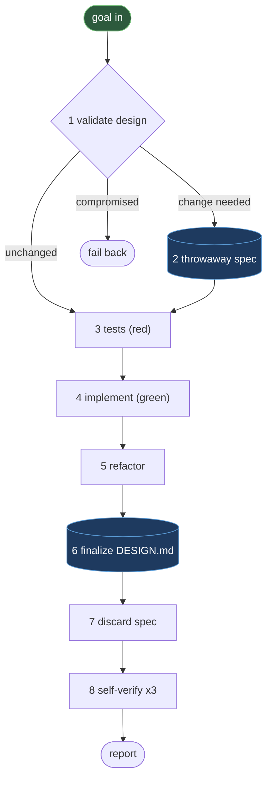

The DTDD loop is the repeating unit of work that every component change passes through. A **worker** owns exactly one component and receives a technical goal — not an instruction sheet — then runs eight steps in order: validate the design first, derive tests from it, write the minimal code that passes them, refactor under a green suite, and write the canonical design doc last against what actually landed. The same discipline runs at two tiers: the worker loop handles a single component; repo-wide orchestration decomposes a change spanning several components into per-component goals, sequences them at their shared boundaries, and holds the gates a worker cannot reach on its own.

## The worker loop

<Steps>
  <Step title="Validate design (gate)">
    Read the component's `DESIGN.md` in full: what it does, who it talks to, what must always hold true. Judge the incoming goal against it and land on **exactly one** of three outcomes:

    - **Unchanged** — the change is a pure implementation detail; the design needs no update. Skip ahead to tests.
    - **Change needed** — the design must evolve to accommodate the goal. Proceed to step 2.
    - **Compromised** — the goal breaks a standing invariant, requires a new dependency, involves an architectural change, or reaches outside the component's scope.

    A **compromised** finding stops the worker cold. It does not improvise a smaller goal, drop the invariant quietly, or expand its own scope. It reports a **failback** with a one-line reason and a suggested alternative, and waits. The design doc is what separates "the agent decided this was fine" from "a documented invariant was checked" — making the failback structural, not a mid-implementation judgment call, is what keeps one compromised component from corrupting a shared contract at a seam.
  </Step>

  <Step title="Draft a throwaway spec">
    When the design must change, write the **delta** — not the whole doc — to a namespaced scratch path: `tmp/<run_id>/<component_name>/spec.md`. Capture the invariants the tests must encode.

    This file is never the canonical doc, is never read outside this run, and is deleted unconditionally in step 7. Design intent needs somewhere to live while it is still being worked out; writing straight into `DESIGN.md` mid-change would leave it half-updated if the run stalls or fails back, where a scratch file can be revised freely without ever exposing a not-yet-true doc as the Fact.
  </Step>

  <Step title="Tests (red)">
    Derive test cases from the throwaway spec, the component's existing invariants, and — at a seam — the pinned contract. Each invariant and contract clause becomes at least one test. Write every test in **Arrange / Act / Assert** form, with those three comments present in the body.

    Run the tests and confirm they **fail for the reason the change predicts** — not a typo, not a missing import. A suite that never went red proves nothing. Confirming the *right* red before the fix is what makes the green in step 4 meaningful evidence rather than coincidence.
  </Step>

  <Step title="Implement (green)">
    Write the **minimal code** that makes the red tests pass. Reconcile any dependency manifest or lockfile immediately if a dependency changed, so later checks run against the real installed state.

    Minimal means minimal: no adjacent refactor, no unrelated cleanup, no scope beyond what step 1 validated. Deferring "while I'm in here" cleanup to step 5 — where it is bounded to no behavior change — keeps the diff traceable to the goal. A reviewer can tell what the change *is* without auditing an unrelated rewrite alongside it.
  </Step>

  <Step title="Refactor">
    Clean up implementation details with the test suite staying green throughout. No behavior change, no scope creep. This is not a second chance to expand the goal.

    Separating "make it work" from "make it clean" keeps the red-green evidence from steps 3–4 intact: refactoring under a green suite is safe because the suite is the proof nothing observable moved.
  </Step>

  <Step title="Finalize DESIGN.md (write-last)">
    Update only the affected sections of `DESIGN.md` to describe what **now exists**, in present tense, present state. Write the canonical doc **once, here, against what actually landed** — never twice for the same change.

    No changelog language ("replaced", "no longer", "previously"), no dates. That dated before/after belongs in the decisions log, a separate document with its own lifecycle. A doc that is both the plan and the record drifts the moment the plan changes mid-run; writing it once, last, against reality is what makes it trustworthy as the Fact the next worker reads at step 1.
  </Step>

  <Step title="Discard the throwaway spec">
    Delete the scratch spec from step 2, unconditionally. The canonical `DESIGN.md` is now the only durable record; nothing else is left around claiming to also describe the design.

    A leftover scratch file is a second, uncurated place someone might later mistake for the Fact. Deleting it removes the ambiguity instead of trusting everyone to know which file is authoritative.
  </Step>

  <Step title="Self-verify × 3">
    Run and **separately report** three distinct checks — all three are reported, not just the first that passes:

    - **Build** — the component actually compiles or emits output. A typecheck is not a build.
    - **Tests** — unit plus self-contained integration. Explicitly name any test that needs live external infrastructure and could not be exercised here. Never silently treat it as passed.
    - **Runtime smoke** — boot or invoke the specific entry point that changed, with a minimal valid input. "Builds" is not "runs."

    Each check catches a failure the others cannot: a passing build can still crash on boot; a passing test suite can still miss the one live integration nobody could run here. Naming what wasn't exercised, rather than staying silent about it, keeps an unavoidable gap from masquerading as a clean pass.
  </Step>
</Steps>

## Enforcement is asymmetric — stated honestly

<Note>
  The loop runs genuine red-green-refactor TDD, with tests derived from real invariants and the pinned contract. But its two disciplines are not enforced the same way.

  The **Design** half is *gate-enforced*: an independent-context review agent checks the staged diff against the doc before a commit can proceed, and structurally blocks the commit if the doc and the code disagree (see [Review Gates](/workflow/review-gates)).

  The **TDD** half is *prompt-enforced* only: the worker is instructed to write tests first and confirm red before green, but nothing mechanically captures proof that red state actually happened. A worker that follows the loop does real test-first development; nothing today stops a worker from writing tests after the fact and simply *claiming* it saw red. Closing that gap — a captured red-state artifact checked before green is allowed — is a known future hardening, not yet built. Overstating this as fully gated would be dishonest about what is actually enforced versus merely instructed.
</Note>

## Document ownership

Every document in a DTDD-managed repository has exactly one owner, decided by who did the reasoning that produced it — never by convenience or by whichever actor happened to be writing at the time.

| Tier | Owner | Timing |
|---|---|---|
| Component code, tests, `DESIGN.md`, component-local README | Worker | `DESIGN.md` read-first at the validate-design gate (step 1); written last (step 6), once the change has landed |
| Shared docs (architecture, data model, decisions log, improvements log, runbooks), deploy config, root README | Orchestrator | At fan-in, after the execute wave — serialized, never written by parallel workers, so an append-only log is never clobbered |
| Templates, root project-instructions file, prompts, skills, agent definitions | Human (approval authority) | Never written autonomously during a run; the orchestrator or a worker may *propose* a change, but a human decides |

A component's worker is the only actor that reasoned about that component's internals, so it alone writes its `DESIGN.md`. The orchestrator is the only actor that reasoned across components, so it alone writes the shared docs — once, at fan-in, after every worker has reported, never mid-run against a plan that might still change.

## What to read next

<CardGroup cols={2}>
  <Card title="Orchestration" href="/workflow/orchestration">
    How the DTDD orchestrator decomposes multi-component changes, pins contracts at seams, and holds the two human gates a worker cannot reach.
  </Card>
  <Card title="Testing" href="/workflow/testing">
    The three-checks discipline behind step 8 — why build, tests, and runtime smoke are distinct claims that must be reported separately.
  </Card>
  <Card title="Review Gates" href="/workflow/review-gates">
    The stamp-gated pre-commit hook and the design-sync agent that enforce the Design half of the loop.
  </Card>
  <Card title="Design Docs" href="/concepts/design-docs">
    The present-state writing rule and twelve-section structure that the loop reads at step 1 and writes at step 6.
  </Card>
</CardGroup>
